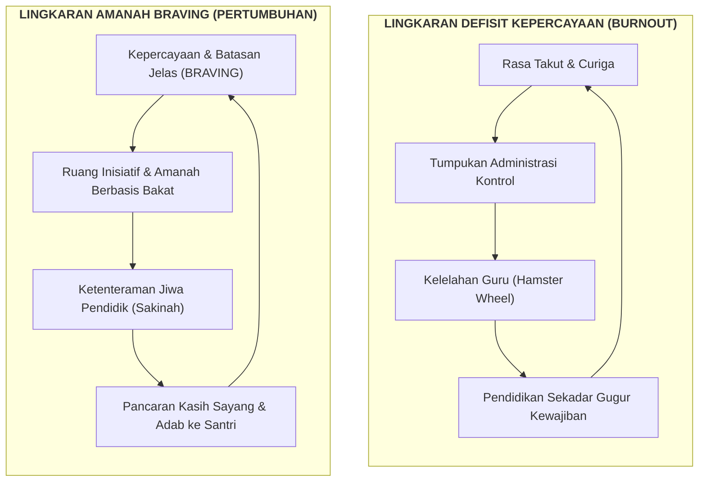

<!-- ========================================================================== -->
<!-- ZONA 1: HEADER, ACTION BAR & METADATA                                      -->
<!-- ========================================================================== -->

# 🏛️ Kepemimpinan Lembaga Berbasis Kepercayaan (BRAVING)

  📖 Baca Artikel
  <a href="/Kajian Video/Workshop Manajemen Implementasi PKN Lembaga Batch 1#sesi-6" class="wiki-action-item">🎬 Tonton Sesi 6 Workshop Batch 1</a>
  <a href="/Panduan/lembaga-dan-guru" class="wiki-action-item">🏫 Panduan Lembaga & Guru</a>
  Manajemen Institusi PKN • Budaya Lembaga

<!-- ========================================================================== -->
<!-- ZONA 2: INFOBOX & RINGKASAN EKSEKUTIF                                      -->
<!-- ========================================================================== -->

  
Kepemimpinan BRAVING

  

    

      
🤝 Trust

      
Pilar Kepemimpinan PKN

    

    
Kerangka Amanah & Integritas Institusi

  

  <table class="wiki-infobox-table">
    <tr>
      <th>Topik Inti</th>
      <td><b>Kepemimpinan Berbasis Kepercayaan (BRAVING)</b></td>
    </tr>
    <tr>
      <th>Tingkat Otoritas</th>
      <td><b>Tier 2: Manajemen & Tata Kelola Lembaga</b></td>
    </tr>
    <tr>
      <th>Acuan Utama</th>
      <td>Materi Manajemen Implementasi PKN Ver 5.0 (Slide 29–30)</td>
    </tr>
    <tr>
      <th>Penerapan</th>
      <td>Yayasan, Kepala Sekolah, Dewan Asatidzah, Wali Santri</td>
    </tr>
    <tr>
      <th>Kaidah Asas</th>
      <td>Koneksi Sebelum Koreksi (Di Tingkat Organisasi)</td>
    </tr>
  </table>

> [!SUMMARY] ⚡ Ringkasan Eksekutif (TL;DR Lead Section)
> **Karakter Santri Tidak Akan Mekar di Atas Tanah Ketakutan dan Kecurigaan:**
> Dalam implementasi Pendidikan Karakter Nabawiyah (PKN), budaya kepemimpinan di tingkat yayasan dan manajemen sekolah adalah hulu dari seluruh proses pendidikan. Kerangka **BRAVING** mengadaptasi 7 instrumen kepercayaan inter-personal menjadi fondasi manajerial sekolah Islam guna menghapus budaya saling menyalahkan (*blame game*), memutus "roda hamster administratif", dan memampukan para asatidzah mendidik dengan ketenangan jiwa (*sakinah*).

---

## 🎯 Mengapa Implementasi PKN Membutuhkan Budaya Kepercayaan?

Banyak lembaga gagal menerapkan PKN bukan karena kurikulumnya keliru, melainkan karena **defisit kepercayaan (trust deficit)** di antara pemangku kepentingan:
* Pengurus yayasan mencurigai efektivitas kerja kepala sekolah dan guru.
* Guru merasa terancam dan takut berinisiatif karena kesalahan kecil langsung diganjar teguran keras.
* Terjadi penumpukan beban administrasi sebagai instrumen pengawasan mekanis yang melelahkan (*burnout*).

Dalam kaidah nabawiyah, kepemimpinan berakar pada sifat **Amanah** dan **Sidq**. Hubungan antara pimpinan dan guru harus dibangun di atas rasa aman psikologis (*psychological safety*), di mana setiap personil diperlakukan sebagai manusia berjiwa yang sedang bersama-sama meniti jalan tazkiyah.

---

## 🧭 Tujuh Pilar Kepemimpinan BRAVING

Materi Workshop Manajemen Implementasi PKN mengoperasionalkan kata **BRAVING** menjadi 7 komitmen perilaku harian para pimpinan lembaga:

### 1. B — Boundaries (Menghormati Batasan Peran)
* **Makna:** Setiap personil memahami dengan jernih apa yang menjadi wewenang dan ranah tanggung jawabnya, serta menghormati batasan ranah orang lain.
* **Praktik Sekolah:** Yayasan tidak melakukan intervensi teknis kelas harian yang menjadi ranah guru; guru tidak melangkahi kewenangan manajerial kepala sekolah. Ketika batasan ini dihormati, ruang kerja menjadi tertib tanpa kecemasan tumpang-tindih perintah.

### 2. R — Reliability (Keandalan & Menepati Janji)
* **Makna:** *Do what you say you will do.* Menjaga keselarasan antara ucapan di depan rapat dengan eksekusi nyata di lapangan.
* **Praktik Sekolah:** Pimpinan menepati komitmen penyediaan fasilitas pendukung, dukungan kebijakan, dan hak gaji guru. Guru menepati komitmen jadwal pendampingan santri tanpa mengorbankan waktu kelas untuk urusan pribadi.

### 3. A — Accountability (Berani Mengakui Khilaf & Memperbaiki)
* **Makna:** Sikap ksatria untuk mengakui kesalahan diri tanpa melemparkan tanggung jawab kepada bawahan atau mencari kambing hitam.
* **Praktik Sekolah:** Ketika sebuah program kegiatan berjalan kurang lancar, pimpinan membuka evaluasi dengan muhasabah arahan manajemen, bukan langsung menghakimi panitia pelaksana. Santri dan guru belajar dari keteladanan pimpinan yang beristighfar dan berbenah.

### 4. V — Vault (Menjaga Kerahasiaan & Aib)
* **Makna:** Menjaga amanah cerita, tidak mengumbar keluhan bawahan di forum terbuka, dan menutup aib santri maupun wali santri.
* **Praktik Sekolah:** Kasus pelanggaran adab santri atau catatan kekurangan guru dibahas secara empat mata dalam ruang tertutup (*tashih khash*), bukan dijadikan bahan gosip di ruang guru atau contoh negatif di mimbar upacara.

### 5. I — Integrity (Integritas Nilai di Atas Kepentingan Sesaat)
* **Makna:** Memilih berpegang teguh pada kebenaran syariat dan nilai akhlaq meskipun berat, tidak populer, dan menuntut pengorbanan finansial.
* **Praktik Sekolah:** Sekolah menolak manipulasi nilai rapor demi menaikkan akreditasi dinas; menolak menerima suap atau pungutan liar; dan tetap konsisten memegang kaidah *adab sebelum ilmu* meskipun menghadapi desakan pihak luar yang hanya mengukur hasil instan.

### 6. N — Non-Judgment (Ruang Dialog Tanpa Penghakiman Terburu-Buru)
* **Makna:** Pendidik dan pimpinan mampu mendengarkan keluhan, kesulitan, dan kegagalan personil tanpa buru-buru menyematkan label negatif.
* **Praktik Sekolah:** Ketika seorang guru curhat bahwa ia merasa kesulitan mengendalikan kelas, pimpinan merespons dengan tawaran bimbingan (*mentoring*), bukan dengan cemooh bahwa guru tersebut tidak kompeten.

### 7. G — Generosity (Mengedepankan Husnudzan)
* **Makna:** Selalu menafsirkan ikhtiar, keterlambatan, atau kekurangan rekan kerja dari niat terbaik yang mungkin ada di balik tindakan tersebut.
* **Praktik Sekolah:** Jika guru terlambat mengirimkan laporan mingguan, pimpinan tidak langsung menuduh guru malas, melainkan menanyakan apakah ada kendala kesehatan keluarga atau kendala santri yang sedang membutuhkan penanganan darurat.

---

## 📊 Matriks Penyelarasan Tim: Visi vs Bakat

Dalam mengelola sumber daya pendidik di sekolah, kerangka kepemimpinan PKN membedakan secara tegas antara dua dimensi:

| Dimensi | Pertanyaan Penentu | Sikap Pimpinan Sekolah |
|---|---|---|
| **Keselarasan Visi (Directional Alignment)** | *Apakah guru ini memiliki aqidah, manhaj, dan nilai hidup yang selaras dengan cita-cita yayasan?* | **Mutlak & Non-Nego:** Jika tidak selaras visi dasarnya, ia akan menjadi sumber resistensi kronis di dalam tim. Harus disamakan persepsinya sejak proses seleksi awal. |
| **Kecocokan Peran (Role Fitness)** | *Apakah penugasan harian guru ini sesuai dengan bakat alamiah dan keunikan fitrah personalnya?* | **Fleksibel & Adaptif:** Guru yang introver dan cermat data ditempatkan di riset kurikulum; guru yang hangat dan sabar ditempatkan di pendampingan usia dini; guru yang tegas dan dinamis memimpin proyek outdoor. |

---

## 🛠️ Checklist Evaluasi Diri Pimpinan (Self-Audit Leadership)

Gunakan daftar periksa berikut dalam rapat evaluasi berkala pimpinan yayasan dan kepala sekolah:

- [ ] **B:** Apakah setiap guru memiliki deskripsi wewenang yang jelas sehingga tidak takut disalahkan secara sepihak?
- [ ] **R:** Apakah ada janji manajemen terkait fasilitas belajar yang belum ditepati kepada guru dan murid?
- [ ] **A:** Apakah kita sebagai pimpinan sudah terbiasa meminta maaf dan berbenah ketika membuat keputusan yang keliru?
- [ ] **V:** Apakah rekam jejak konseling santri dan masalah pribadi guru terjaga rapi dalam arsip rahasia?
- [ ] **I:** Apakah kita berani menolak kebijakan komersialisasi sekolah yang melanggar nilai kesederhanaan nabawiyah?
- [ ] **N:** Apakah para guru merasa nyaman menyampaikan kesulitan mengajarnya kepada kepala sekolah?
- [ ] **G:** Apakah kita mengawali setiap telaah masalah dengan berbaik sangka (*husnudzan*) kepada ikhtiar tim lapangan?

---

## 🔗 Tautan Terkait

- 🎬 **Rekaman Workshop Terkait:** [[Kajian Video/Workshop Manajemen Implementasi PKN Lembaga Batch 1#sesi-6|Sesi 6 Workshop Batch 1: Analisis SWOT & Kepemimpinan BRAVING]]
- 🏫 **Panduan Terapan Sekolah:** [[Panduan/lembaga-dan-guru|Panduan Lembaga & Guru]]
- 📋 **Standarisasi Pendidik:** [[Paradigma - Implementasi PKN/Dokumen Pendidikan Karakter Nabawiyah/Paradigma & Implementasi/Implementasi/Kaidah & Elemen/8 Standar Implementasi PKN|8 Standar Implementasi PKN]]
- 💡 **Kaidah Manajemen Perubahan:** [[Paradigma - Implementasi PKN/Dokumen Pendidikan Karakter Nabawiyah/Paradigma & Implementasi/Implementasi/Kaidah & Elemen/4 Kaidah Implementasi|4 Kaidah Pokok Implementasi]]
