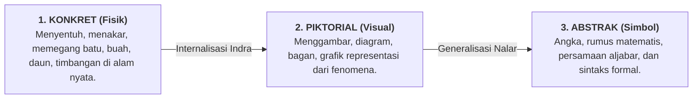

<!-- ========================================================================== -->
<!-- ZONA 1: HEADER, ACTION BAR & METADATA                                      -->
<!-- ========================================================================== -->

# 🌿 Metode Belajar Alamiah CPA dan Model Sandbox di Era AI

<div class="wiki-action-bar">
  <span class="wiki-action-item active">📖 Baca Panduan</span>
  <a href="/Kajian Video/Workshop Manajemen Implementasi PKN Lembaga Batch 1#sesi-8" class="wiki-action-item">🎬 Tonton Sesi 8 & 10 Workshop Batch 1</a>
  <a href="/Panduan/lembaga-dan-guru" class="wiki-action-item">🏫 Panduan Lembaga & Guru</a>
  <span class="wiki-action-meta">Pedagogi Alamiah • Pembelajaran KBM</span>
</div>

<!-- ========================================================================== -->
<!-- ZONA 2: INFOBOX & RINGKASAN EKSEKUTIF                                      -->
<!-- ========================================================================== -->

<div class="wiki-infobox">
  <div class="wiki-infobox-header">Pedagogi Alamiah & Sandbox</div>
  <div class="wiki-infobox-image">
    <div style="padding: 1.25rem 1rem; background: linear-gradient(135deg, rgb(13, 148, 136), rgb(30, 58, 138)); color: white; text-align: center; border-radius: 6px;">
      <div style="font-size: 1.8rem; font-weight: 700; margin-bottom: 0.35rem;">🌱 Fitrah</div>
      <div style="font-weight: 600; font-size: 0.9rem;">Desain Pembelajaran Nyata</div>
    </div>
    <div class="wiki-infobox-caption">Integrasi Alam, Logika & Nalar Kritis</div>
  </div>
  <table class="wiki-infobox-table">
    <tr>
      <th>Topik Inti</th>
      <td><b>CPA, Sandbox & Belajar di Era AI</b></td>
    </tr>
    <tr>
      <th>Tingkat Otoritas</th>
      <td><b>Tier 2: Desain Pembelajaran Lapangan</b></td>
    </tr>
    <tr>
      <th>Acuan Utama</th>
      <td>Materi Manajemen Implementasi PKN Ver 5.0 (Slide 37–40)</td>
    </tr>
    <tr>
      <th>Penerapan</th>
      <td>KBM Matematika, Sains Alamiah, Bahasa, Proyek Mandiri</td>
    </tr>
    <tr>
      <th>Prinsip Pokok</th>
      <td>Belajar dari Benda Nyata Sebelum Lambang Abstrak</td>
    </tr>
  </table>
</div>

> [!SUMMARY] ⚡ Ringkasan Eksekutif (TL;DR Lead Section)
> **Mengembalikan Pembelajaran ke Akarnya yang Alami dan Bermakna:**
> Pendidikan konvensional kerap menjerumuskan anak ke dalam abstraksi dini—memaksa anak menghafal rumus angka dan simbol sebelum memahami wujud fisiknya di alam nyata. Fenomena ini melahirkan fobia belajar dan keterasingan dari ciptaan Allah.
> 
> Pendekatan PKN merestrukturisasi proses belajar melalui:
> 1. **Metode CPA:** Meniti jembatan penalaran dari **Konkret** (benda fisik) $\rightarrow$ **Piktorial** (visual gambar) $\rightarrow$ **Abstrak** (simbol/rumus).
> 2. **Model Sandbox:** Menyediakan ruang aman bagi santri untuk bereksperimen, membuat kekeliruan tanpa rasa takut, dan menanggung konsekuensi logis secara terbimbing.
> 3. **Benteng Adab di Era AI:** Memposisikan kecerdasan buatan sebagai alat komputasi, seraya menajamkan keunggulan fitrah manusia yang tak tertandingi: *hati nurani, keteladanan qudwah, daya nalar hikmah, dan verifikasi kebenaran (tabayyun)*.

---

## 🪜 1. Metode CPA: Tangga Pemahaman Alamiah

Metode **CPA (Concrete $\rightarrow$ Pictorial $\rightarrow$ Abstract)** memastikan otak anak mengonstruksi makna secara bertahap sesuai fitrah perkembangan akal:



### Praktik CPA dalam Matematika & Sains Nabawiyah:

* **Tahap 1 — Konkret (Sensori & Alamiah):**
  Sebelum anak mengenal pecahan $1/2$ atau $1/4$ di papan tulis, ajak anak membelah buah apel, membagi kurma secara adil di antara teman, atau menakar air dengan gelas ukur. Santri merasakan bobot, volume, dan konsep keadilan secara indrawi.
* **Tahap 2 — Piktorial (Representasi Visual):**
  Santri menggambar pembagian apel tersebut di buku jurnalnya, mengarsir diagram lingkaran, atau menyusun balok balok gambar. Di tahap ini, santri memahami bahwa gambar mewakili benda nyata.
* **Tahap 3 — Abstrak (Simbol & Kaidah):**
  Guru baru memperkenalkan angka pembilang dan penyebut: $\frac{1}{2}$, $\frac{1}{4}$, beserta dalil zakat atau waris yang terkait. Karena tahapan konkret dan piktorialnya telah matang, santri memahami esensi rumus dan tidak mengalami kecemasan matematika (*math anxiety*).

---

## 📦 2. Model Pembelajaran *Sandbox* (Kotak Pasir)

Dalam rekayasa perangkat lunak dan pendidikan, konsep **Sandbox** adalah area simulasi tertutup yang aman dari bahaya fatal, tempat pembelajar bebas mencoba hal baru tanpa takut sistem hancur:

### Karakteristik Sandbox Pendidikan PKN:
1. **Ruang Eksplorasi Berbatas (*Safe Boundary*):** Guru menentukan batas-batas syariat, keselamatan fisik, dan alokasi waktu yang jelas.
2. **Kemerdekaan Memilih & Mengambil Risiko:** Di dalam batas tersebut, santri bebas menentukan langkah, rancangan proyek, dan eksperimen mereka sendiri.
3. **Konsekuensi Logis, Bukan Hukuman Marah:** Jika tanaman layu karena lupa disiram, konsekuensi logisnya tanaman mati dan santri belajar siklus air; guru tidak membentak melainkan mengajak refleksi muhasabah (*"Mengapa air penting bagi kehidupan?"*).

```
   ┌────────────────────────────────────────────────────────┐
   │                   SANDBOX KELAS                        │
   │  (Simulasi Pasar, Riset Kebun Kelas, Jurnal Mandiri)   │
   │                                                        │
   │  • Bereksperimen dengan ide                            │
   │  • Terjadi kesalahan & kegagalan kecil                 │
   │  • Refleksi & perbaikan terbimbing                     │
   └───────────────────────────┬────────────────────────────┘
                               │
             Transisi ke Dunia Nyata (Out of the Box)
                               ↓
   ┌────────────────────────────────────────────────────────┐
   │                  DUNIA NYATA PENUH                     │
   │  (Pasar Rakyat, Magang Masyarakat, Panitia Acara Riil) │
   │                                                        │
   │  • Memikul amanah sesungguhnya                         │
   │  • Interaksi sosial lintas generasi                    │
   │  • Ujian adab & kemandirian akil baligh                │
   └────────────────────────────────────────────────────────┘
```

---

## 🤖 3. Menghadapi Era Artificial Intelligence (AI) dengan Manhaj Nabawiyah

Kehadiran teknologi AI (seperti Large Language Models) mengguncang paradigma sekolah konvensional yang selama ini mengagungkan hafalan materi dan tugas ringkasan teks. Dalam hitungan detik, mesin kecerdasan buatan mampu menghasilkan makalah, menyelesaikan soal ujian, dan menyusun kode program.

### Pertanyaan Mendasar Pendidik:
> *"Jika AI bisa mengerjakan semua tugas sekolah, apa yang tersisa dari peran pendidikan bagi anak-anak kita?"*

Materi Workshop Manajemen Implementasi PKN menegaskan bahwa **AI justru membersihkan pendidikan dari formalisme semu**:

| Dimensi | Yang Dihasilkan AI | Keunggulan Fitrah Manusia (PKN) |
|---|---|---|
| **Pengetahuan** | Sintesis data statistik tanpa rasa dan tanpa keyakinan (*ilm zhahir*). | Pemahaman hikmah berlandaskan wahyu, rasa takut kepada Allah (*khasyyah*), dan iman. |
| **Penyampaian** | Teks dingin di layar monitor. | Pancaran keteladanan (*qudwah hasanah*), doa sepertiga malam guru, dan pelukan kasih sayang. |
| **Karya** | Kompilasi algoritma yang meniru pola lama. | Amal sholih yang diniatkan ikhlas mengharap ridha Allah demi kemaslahatan ummah. |
| **Pencarian Informasi** | Halusinasi dan pencampuran informasi benar-salah. | Sikap kritis *Tabayyun*, adab memeriksa sanad, dan integritas moral kejujuran ilmiah (*shidq*). |

### Tiga Strategi KBM Menghadapi Disrupsi AI:

1. **Ubah Format Tugas Menjadi Aksi Konkret & Portofolio Karya:**
   Hentikan tugas berbasis merangkum artikel dari internet yang rawan plagiasi AI. Gantilah dengan tugas observasi langsung di lapangan: wawancara dengan pedagang pasar, merawat hewan ternak, membuat prototipe pertukangan, atau mengajar adik kelas.
2. **Jadikan AI sebagai "Mitra Uji Nalar" (*Challenger Tool*):**
   Gunakan AI dalam sandbox kelas untuk melatih santri mendeteksi kekeliruan argumen (*critical thinking*): *"Tanyakan pada AI tentang hukum suatu muamalah, lalu bedah apakah rujukan dalilnya shahih atau terdistorsi."*
3. **Pertahankan Adab Literasi Mendalam (*Deep Reading*):**
   Membiasakan santri membaca kitab fisik, mentadabburi ayat secara perlahan, dan menulis tangan refleksi hati. Ini menjaga fokus pikiran santri dari sindrom rentang perhatian pendek (*short attention span*) akibat gawai.

---

## 🛠️ Langkah Integrasi ke RPP Kelas

Guru dapat mengintegrasikan konsep ini ke dalam RPP 1 lembar dengan langkah sederhana:

1. **Identifikasi Konsep:** Tentukan konsep abstrak apa yang ingin dipelajari (misal: siklus fotosintesis atau pecahan).
2. **Rancang Fase Konkret:** Siapkan daun asli dan sinar matahari di kebun sekolah sebelum membuka buku paket.
3. **Tetapkan Sandbox:** Beri ruang santri menanam biji kacang hijau di media berbeda untuk mengamati pertumbuhannya.
4. **Refleksi Hikmah:** Tutup pembelajaran dengan merenungkan ayat Al-Qur'an tentang kuasa Allah menghidupkan bumi yang mati (QS. Fathir: 9).

---

## 🔗 Tautan Terkait

- 🎬 **Rekaman Workshop:** [[Kajian Video/Workshop Manajemen Implementasi PKN Lembaga Batch 1#sesi-8|Sesi 8 (Metode Belajar Nyata)]] & [[Kajian Video/Workshop Manajemen Implementasi PKN Lembaga Batch 1#sesi-10|Sesi 10 (Belajar di Era AI)]]
- 🏫 **Panduan Guru:** [[Panduan/lembaga-dan-guru|Panduan Lembaga & Guru]]
- 📝 **Alat Pembelajaran:** [[Toolkit KBM/Template RPP Karakter Nabawiyah 1 Lembar|Template RPP Karakter Nabawiyah 1 Lembar]]
- 🧭 **Standar Kurikulum:** [[Paradigma - Implementasi PKN/Dokumen Pendidikan Karakter Nabawiyah/Paradigma & Implementasi/Implementasi/Kaidah & Elemen/8 Standar Implementasi PKN|8 Standar Implementasi PKN]]
