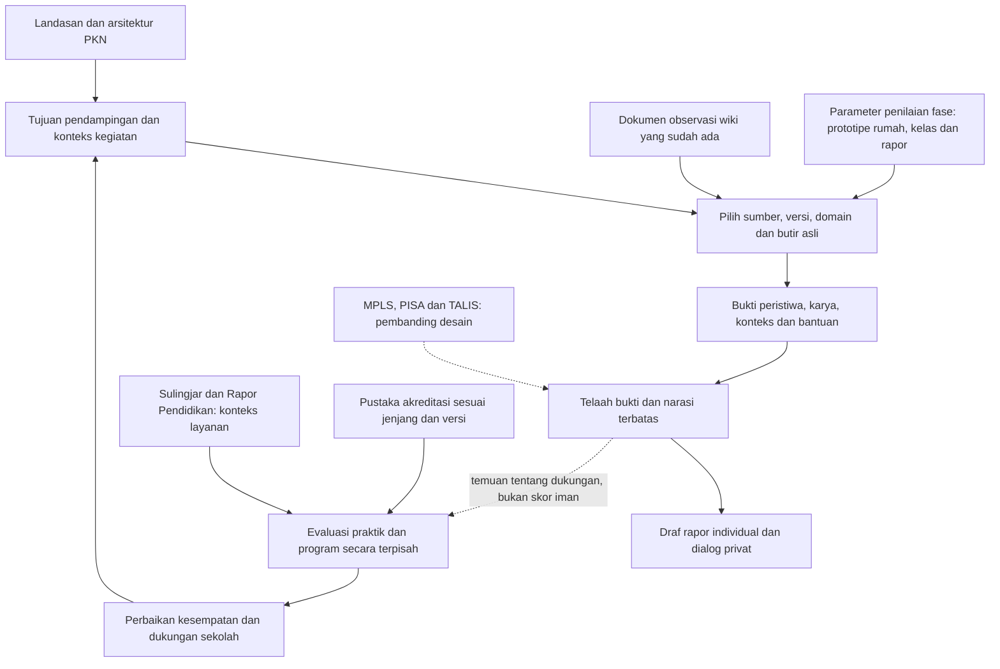
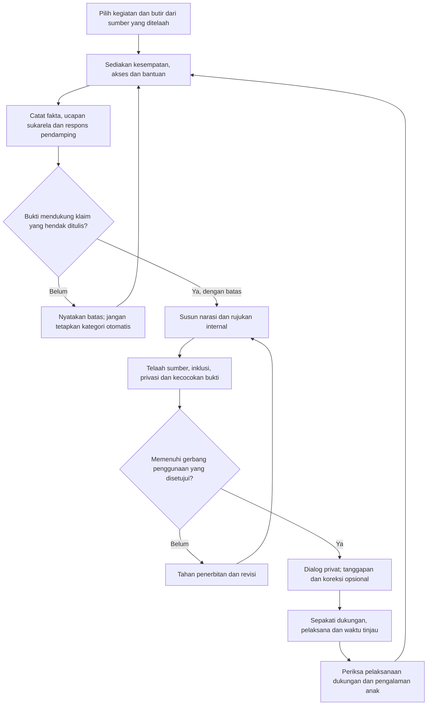

# Bagan dan TODO Pengembangan Rapor PKN

> [!WARNING] Usulan arsitektur dan agenda telaah
> Bagan bukan standar resmi atau bukti validitas. Kotak proses tidak berarti proses tersebut telah dilaksanakan. Semua pekerjaan manusia yang belum dilakukan tetap terbuka. [Indeks paket](index.md).

## 1. Hubungan sumber dan keluaran

**Batas aliran:** laporan anak tidak dikonversi menjadi skor akreditasi. Kinerja pendidik/lembaga diperiksa dari bukti praktik dan pengalaman warga sekolah yang relevan, bukan semata kumpulan rapor. Sumber eksternal tidak memasok validitas atau ambang kategori PKN. Dasar hubungan terdapat pada [analisis komparatif](01%20-%20Analisis%20Komparatif.md), [peta observasi](02%20-%20Peta%20Sumber%20dan%20Poin%20Observasi.md), dan [kajian akreditasi](04%20-%20Keselarasan%20Akreditasi%20dan%20Evaluasi%20Program.md).

## 2. Siklus bukti sampai tindak lanjut

Ini usulan proses, bukan pernyataan bahwa instrumen telah lolos gerbang. Risiko keselamatan memakai jalur perlindungan anak yang berwenang, tidak menunggu siklus rapor. Formulir dan contoh sintetis ada pada [draf rapor](03%20-%20Draf%20Alur%20dan%20Format%20Rapor.md).

## 3. TODO prioritas dan kriteria penerimaan

Pemilik di bawah adalah **peran yang perlu ditunjuk**, bukan orang yang telah memberi persetujuan. Tidak ada tanggal, tanda tangan, atau nama reviewer rekaan. Setiap keputusan harus mengacu versi sumber dan draf yang ditelaah.

| Urutan | Pekerjaan terbuka | Peran yang diperlukan | Kriteria penerimaan sebelum lanjut |
|---|---|---|---|
| 1 | Tetapkan tujuan, jenjang, pembaca dan batas keputusan rapor | Penanggung jawab pendidikan dan pemilik materi | Tujuan tertulis; jelas bukan seleksi, hukuman, diagnosis atau pengukuran iman; hubungan dengan rapor formal ditetapkan |
| 2 | Audit provenance dan versi indikator | Pemilik instrumen dan penelaah sumber | Daftar sumber pengendali, heading, nomor domain, tanggal/versi; status primer versus sintesis dan konflik yang belum selesai dicatat |
| 3 | Selesaikan konflik 19/28/18/13 butir dan butir per fase | Pemilik materi dan ahli asesmen | Tidak ada penggabungan nomor atau agregasi lintas versi; keputusan memilih/revisi sumber terdokumentasi, bukan hanya ganti judul |
| 4 | Putuskan makna data kosong dan aturan kecukupan bukti | Ahli asesmen, guru dan ahli inklusi | Kesempatan belum ada, tidak dicatat, bukti terbatas dan bukti bertentangan dibedakan; tidak ada capaian otomatis dari kosong |
| 5 | Telaah kategori, ambang indeks dan kebutuhan grafik | Pemilik instrumen dan ahli asesmen | Perbedaan ambang/radar terdokumentasi; jangan konversi atau total sebelum dasar keputusan sah. Jika tidak diperlukan, keputusan menghilangkannya dicatat |
| 6 | Telaah deskriptor sensitif dan atribusi agama | Penelaah materi PKN/agama, perkembangan dan perlindungan anak | Tidak menyimpulkan hati/niat dari air mata, kepatuhan, suara atau ekspresi; tidak mewariskan ancaman, penghinaan, paksaan, atau diagnosis; pertanyaan berisiko tinggi dieskalasikan |
| 7 | Periksa inklusi, fase dan variasi kesempatan | Ahli perkembangan/inklusi dan guru | Cara komunikasi alternatif, kondisi sensorik/motorik, bantuan, istirahat dan akses dipertimbangkan; usia bukan ambang otomatis; bantuan tidak menurunkan martabat anak |
| 8 | Pisahkan bakat/minat dari identitas permanen | Pemilik TB-40 dan ahli asesmen terkait | Penggunaan profil serta batasnya diputuskan secara khusus; tidak menyamakan 170, 0–100, total ipsatif atau radar; portofolio tetap berjejak kegiatan |
| 9 | Verifikasi aturan pelaporan dan akreditasi aktif | Pengelola satuan dan penelaah regulasi | Sumber resmi, keberlakuan, versi, jenjang/jenis layanan dan locator diperiksa; rapor tidak diklaim cukup membuktikan kinerja lembaga |
| 10 | Tetapkan tata kelola data sebelum data nyata | Pengelola data, penanggung jawab anak dan pihak berwenang | Tujuan, dasar pemrosesan/pemberitahuan, akses, penerima, retensi, penghapusan, koreksi, pencadangan dan respons insiden disetujui; saluran privat diuji sesuai media |
| 11 | Uji keterpahaman memakai kasus sintetis | Guru, wali dan penelaah independen | Pembaca dapat membedakan fakta/tafsir, menemukan batas dan dukungan, serta menjelaskan cara koreksi; salah tafsir direkam dan diperbaiki |
| 12 | Kalibrasi pengamat tanpa memaksa kesepakatan | Ahli asesmen dan pengamat | Pengamat menilai kasus sintetis secara independen, lalu membandingkan bukti dan alasan; bias dan perbedaan konteks dicatat. Kesepakatan saja bukan validitas |
| 13 | Uji beban seluruh alur | Koordinator pelaksana dan pengguna | Waktu observasi, rangkuman, review, dialog, koreksi dan tindak lanjut diukur; akses serta tugas per peran jelas; tidak mengklaim efisiensi 90% dari contoh |
| 14 | Tetapkan media dan sumber pengendali | Pemilik proses dan pengelola teknis | Pertimbangan kertas/dokumen/digital mengikuti kebutuhan; versi dan kesetaraan ekspor terbukti; tidak membuat aplikasi kedua sebelum kebutuhan/integrasi diperiksa |
| 15 | Putuskan uji terbatas nyata secara terpisah | Penanggung jawab, reviewer bidang dan peserta sesuai tata kelola | Semua gerbang yang relevan terpenuhi; protokol, penghentian, penanganan insiden dan hak koreksi disetujui pada versi tertentu; tidak tersirat dari paket ini |
| 16 | Evaluasi konsekuensi dan perbaikan | Tim mutu dan wakil pengguna | Periksa kenyamanan, bias kesempatan, kebocoran, salah tafsir, beban dan pelaksanaan dukungan; hentikan penggunaan berisiko, bukan hanya memperindah narasi |

Sumber pertanyaan keputusan: `side-project/rapor-pendidikan-karakter/riset/09-sintesis-dan-keputusan.md`, §4 dan §6; `riset/02-asesmen-dan-rubrik.md`, konflik sumber; `riset/05-privasi-dan-etika.md`, prasyarat data nyata. Ketiganya catatan riset lokal, bukan persetujuan. Batas eskalasi mengikuti `PANDUAN_PENULISAN_KONTEN.md`, “Gerbang review manusia (HITL)”.

## 4. Checklist status paket

### Hasil dokumentasi

- [x] Indeks dan analisis perbandingan disusun sebagai draf.
- [x] Poin observasi dipetakan ke dokumen yang sudah ada, bukan dibuat sebagai rubrik baru.
- [x] Draf informasi rapor dan contoh sintetis dipisahkan dari instrumen teruji.
- [x] Pustaka akreditasi dan perangkat penilaian fase dipertimbangkan dengan batas unit evaluasi.
- [x] Bagan hubungan/alur dan agenda keputusan manusia disusun.

### Belum menjadi hasil pekerjaan ini

- [ ] Telaah manusia dan persetujuan versi tertentu.
- [ ] Validasi sumber primer seluruh klaim agama, konstruk, ambang dan regulasi terkini.
- [ ] Uji keterpahaman, kalibrasi, efektivitas, inklusi atau beban operasional.
- [ ] Otorisasi penggunaan data anak nyata dan bukti efektivitas kontrol privasi.
- [ ] Publikasi/deployment atau penggantian instrumen lama.

## 5. Pemeriksaan teknis

Pemeriksaan teknis hanya menilai keterbacaan dan keterhubungan dokumen, bukan validitas asesmen, kebenaran agama, kepatuhan hukum, persetujuan manusia, atau kesiapan dipakai. Hasil pemeriksaan dicatat setelah dijalankan; jangan mengubah daftar pekerjaan manusia menjadi selesai karena linter atau render berhasil.

Hasil pemeriksaan paket pada 27 Oktober 2026:

- Enam berkas Markdown mempunyai metadata wajib, status draf/pending, pagar kode berpasangan, dan referensi catatan kaki yang didefinisikan.
- Pemeriksa berbasis parser Markdown menemukan **33 tautan lokal dengan tujuan berkas tersedia**, tanpa tujuan hilang. Penunjuk path sumber lokal yang diperiksa juga tersedia; ini tidak menguji ketersediaan URL eksternal atau versi terbitannya.
- Seluruh **19 nama indikator** pada peta cocok dengan kolom nama indikator toolkit asal; nomor tetap lokal per domain.
- Pratinjau sementara dengan parser Markdown dan Chromium menampilkan enam bagian, 18 tabel, serta **dua diagram Mermaid berhasil dirender menjadi SVG**. Ini smoke render dokumen/diagram, bukan build Quartz atau bukti tampilan final tema situs. Pratinjau tidak memublikasikan draf.
- Linter repo dijalankan khusus folder paket dengan `--check-links`: **0 broken wikilink targets**, tetapi keluar dengan kode 1 dan melaporkan lima halaman bernomor sebagai orphan. Paket memakai tautan Markdown dari indeks; pemeriksaan parser di atas menemukan tujuan lokalnya. Peringatan orphan linter tetap dicatat, tidak dinyatakan lulus atau dihilangkan dengan menghubungkan draf ke navigasi publik.
- Telaah mesin independen digunakan untuk memperjelas atribusi sumber dan contoh lintas konteks. Ini bukan review manusia, pemeriksaan keberlakuan regulasi, atau validasi asesmen.

Build Quartz, deployment, uji lapangan dan signoff manusia **tidak dilakukan**. Sebelum publikasi, periksa render tema, tautan/anchor pada keluaran Quartz, perilaku filter draf, dan gerbang editorial yang relevan.
